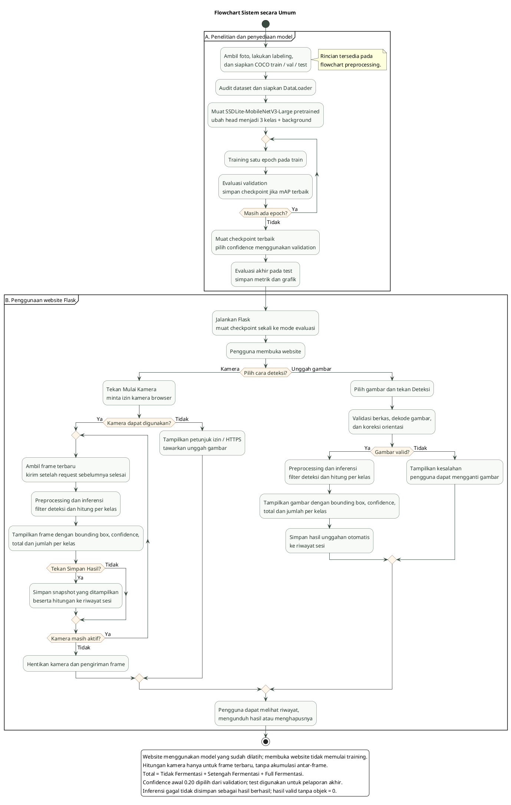
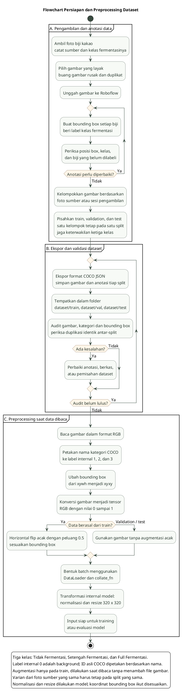
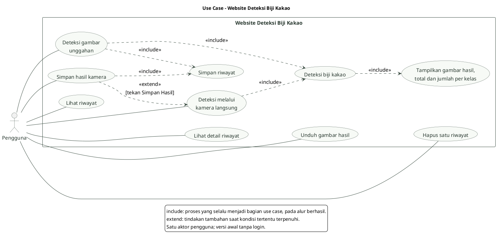
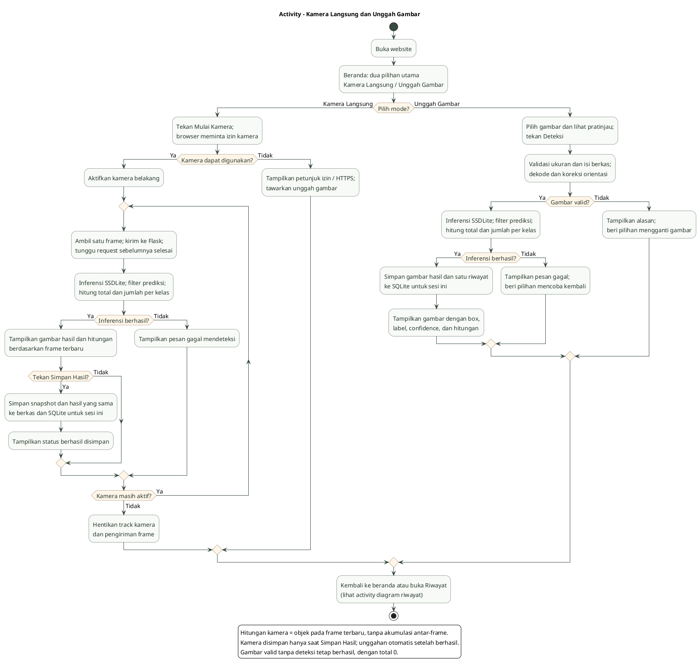
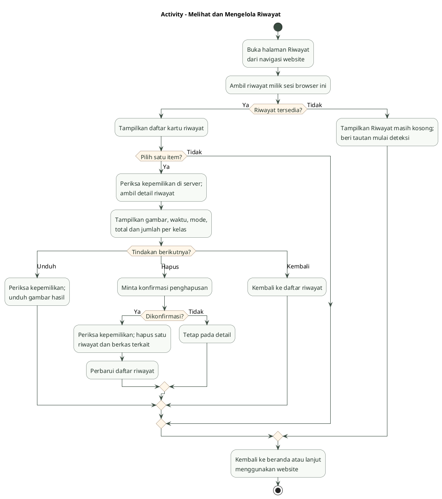

# Diagram penelitian dan rancangan website biji kakao

Dokumentasi ini menggunakan model resmi SSDLite-MobileNetV3-Large dari TorchVision. Bagian website Flask menggambarkan rancangan deployment yang diminta: kamera browser, unggah gambar, jumlah objek per kelas, serta riwayat.

Untuk menyimpan gambar, buka file PNG dan gunakan tombol unduh atau simpan gambar pada browser. SVG dapat diperbesar tanpa kehilangan ketajaman. Berkas `.puml` merupakan sumber PlantUML yang dapat diedit.

## Flowchart sistem secara umum

Alur ini mencakup persiapan data, training, validation, evaluasi test, penggunaan checkpoint terbaik, dan penggunaan website. Training dilakukan sebelum deployment. Website menggunakan checkpoint untuk inferensi.

[PNG](flowchart_system.png) · [SVG](flowchart_system.svg) · [Sumber PlantUML](flowchart_system.puml)

## Flowchart persiapan dan preprocessing dataset

Pengambilan foto dan labeling merupakan persiapan data. Pembacaan RGB, konversi bounding box dan tensor, serta transformasi model merupakan preprocessing. Horizontal flip acak hanya diterapkan pada train dan berlangsung saat gambar dibaca untuk training.

[PNG](flowchart_preprocessing.png) · [SVG](flowchart_preprocessing.svg) · [Sumber PlantUML](flowchart_preprocessing.puml)

Pembagian train, validation, dan test memperhatikan kelompok foto sumber/sesi. Semua versi dari foto sumber yang sama berada pada split yang sama. Resize ke 320 × 320 dan normalisasi dilakukan secara internal oleh model TorchVision. Kategori COCO dipetakan berdasarkan nama; ID mentah tidak diasumsikan sama dengan label internal.

## Use case diagram

Aktor utama adalah Pengguna. `include` menggambarkan proses wajib pada alur berhasil, sedangkan `extend` menggambarkan tindakan tambahan pada kondisi tertentu. Menyimpan hasil kamera dilakukan ketika pengguna menekan Simpan Hasil.

[PNG](use_case.png) · [SVG](use_case.svg) · [Sumber PlantUML](use_case.puml)

## Activity diagram deteksi

Kamera menampilkan hitungan pada frame terbaru. Unggahan berhasil disimpan otomatis ke riwayat; kamera menyimpan satu snapshot ketika tombol Simpan Hasil ditekan. Akses kamera browser ponsel ke server laptop membutuhkan HTTPS.

[PNG](activity.png) · [SVG](activity.svg) · [Sumber PlantUML](activity.puml)

## Activity diagram riwayat

Riwayat dipisahkan per sesi browser, dengan alur melihat detail, mengunduh hasil, dan menghapus satu item setelah konfirmasi.

[PNG](activity_history.png) · [SVG](activity_history.svg) · [Sumber PlantUML](activity_history.puml)

## Prompt implementasi

[Buka prompt notebook dan website Flask](PROMPT_FLASK_KAKAO.md).
