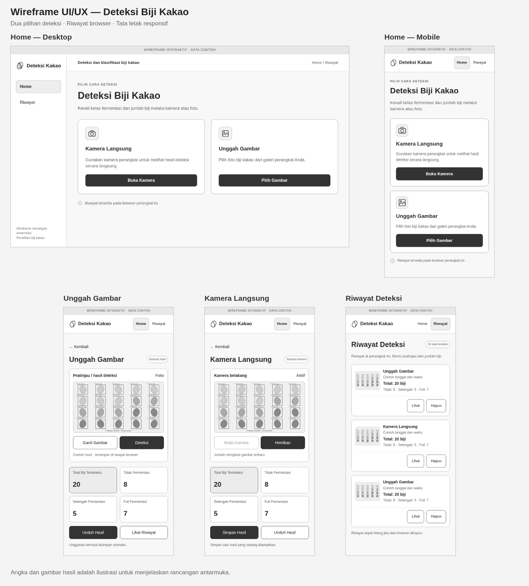

# Rancangan ringkas sistem deteksi biji kakao

Versi ini memakai riwayat browser **localStorage**, maksimal 10 hasil berupa metadata dan thumbnail kecil. Riwayat tersedia pada browser/perangkat yang sama, tanpa SQL atau database server, dan dapat hilang jika data browser dihapus. Unggahan berhasil disimpan otomatis; kamera disimpan ketika tombol Simpan Hasil ditekan.

[Baca prompt implementasi terbaru](PROMPT_FLASK_KAKAO.md).

## Flowchart sistem secara umum

[PNG](flowchart_system.png) · [SVG](flowchart_system.svg) · [Sumber DOT](flowchart_system.dot)

## Flowchart persiapan dan preprocessing data

[PNG](flowchart_preprocessing.png) · [SVG](flowchart_preprocessing.svg) · [Sumber DOT](flowchart_preprocessing.dot)

Pengambilan foto dan labeling adalah persiapan data. Split memperhatikan kelompok sumber sebelum augmentasi. Horizontal flip 50% hanya diterapkan pada train saat data dibaca; resize dan normalisasi dilakukan secara internal oleh model.

## Use case diagram

[PNG](use_case.png) · [SVG](use_case.svg) · [Sumber PlantUML](use_case.puml)

## Activity diagram

[PNG](activity.png) · [SVG](activity.svg) · [Sumber PlantUML](activity.puml)

Diagram menampilkan alur inti. Pada kamera, ambil frame–inferensi–hasil berulang hingga Hentikan. Hitungan menunjukkan frame terbaru, tanpa akumulasi antar-frame. Penyimpanan berlangsung di browser, sehingga lajur Sistem mencakup antarmuka JavaScript dan server inferensi Flask.

## Wireframe UI/UX

[Home desktop](wireframe_home_desktop.png) · [Home mobile](wireframe_home_mobile.png) · [Unggah gambar](wireframe_upload_mobile.png) · [Kamera](wireframe_camera_mobile.png) · [Riwayat](wireframe_history_mobile.png)

[Board SVG](wireframe_board.svg) · [Wireframe interaktif HTML](UI_WIREFRAME.html)

Untuk mencoba wireframe interaktif, unduh `UI_WIREFRAME.html` melalui Raw/Download di GitHub, lalu buka berkas tersebut di browser. Prototipe memakai data contoh untuk navigasi, hasil, dan riwayat. Ini merupakan wireframe; integrasi model Flask dijelaskan dalam prompt implementasi.

Pilihan utama Home adalah Kamera Langsung dan Unggah Gambar. Hasil berada pada halaman deteksi. Navigasi cukup Home dan Riwayat. Contoh angka 20 = 8 + 5 + 7 adalah ilustrasi tampilan.
